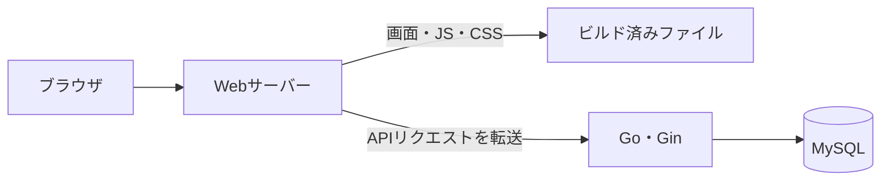

# 構成と技術選定

## 前提

Raspberry Pi 5で、自分の関心がある情報を集めて表示する。最初は株価の騰落率と出来高倍率を確認する画面を作る。

個人で管理できる構成と、技術を学ぶ機会を重視する。技術選定は性能だけで決めず、使い慣れていることや触ってみたいことも理由とする。

## 採用済みの技術

| 技術 | 役割 | 選定理由 |
| --- | --- | --- |
| Go | APIと取得・保存・分析処理 | Goを勉強したいため |
| Gin | HTTPのルーティングとHandlerの実行 | Ginを勉強したいため |
| MySQL | 銘柄と株価日足の保存 | 使い慣れているため |
| Docker Compose | API・DBなどの起動と接続の管理 | 自宅サーバーで複数のサービスをまとめて管理するため |

APIはJSONを返し、株価の分析はGo側で行う。フロントエンドは表示と操作を担当する。

## フロントエンドの構成

`apps/web`にSvelte・TypeScript・Viteのひな形を導入済み。ローカルの開発サーバーで起動でき、型チェックと本番用ビルドを確認している。株価画面とAPI接続は未実装で、Composeの`web`サービスもまだ存在しない。

現在のパッケージ管理はnpmを使用し、`package-lock.json`を管理する。pnpmも候補として検討したが、移行は実施していない。

| 技術 | 役割 | 選定理由 |
| --- | --- | --- |
| Svelte | 画面と状態の管理 | 触ってみたい技術であり、最初の小さな画面を作りながら学ぶため |
| TypeScript | データや関数の型定義 | APIレスポンスなどの扱いをコード上で明確にするため。受信JSONの実行時検証は別途必要に応じて扱う |
| Vite | 開発サーバーと本番用ビルド | Svelte＋TypeScriptのテンプレートから小さく始められるため |

### 比較した選択肢

| 選択肢 | 今回の判断 |
| --- | --- |
| React＋TypeScript＋Vite | 当初の候補。今回はSvelteを学ぶ関心を優先した |
| Angular | 使用経験はあるが、今回は別の技術を試す |
| Vue | 本人の希望により今回は候補から外した |
| SvelteKit | ルーティングなどを含む選択肢。最初は1画面と既存Go APIで始めるため、現時点では導入しない |

次に実装する株価画面は、日付の選択、騰落率と出来高倍率の表、読み込み中・データなし・エラーの表示に絞る。

## 本番の配信構成（案）

フロントもDocker Composeで管理する。Node.jsでビルドし、生成されたHTML・CSS・JavaScriptをWebサーバーから配信する。Node.jsはビルド段階で使用し、本番の配信用コンテナでは常駐させない。

Webサーバーを画面とAPIの共通の入口にする。フロントからは`/api/daily-volume-ratios`などの相対URLで呼び出し、Webサーバーが`/api`を除いてGo APIへ転送する。現在のGo APIのパスは`/daily-volume-ratios`などであり、この転送設定はまだ実装していない。

### 配信サーバーの候補（未確定）

| 選択肢 | 利点・考慮点 | 現時点の判断 |
| --- | --- | --- |
| Nginx | 静的ファイル配信とAPIへの転送を担当できる | 当初の構成案。採用可能 |
| Caddy | 同じ役割を短い設定で記述でき、HTTPS証明書の取得・更新も条件に応じて自動化できる | 設定の簡潔さから第一候補として提案中。採用は未確定 |
| Goで直接配信 | Webサーバー用コンテナを減らせる。一方、画面とAPIのビルド・デプロイが結び付く | フロントを別コンテナで管理する方針のため、現時点では採用しない |
| Apache HTTP Server | 静的ファイル配信とAPIへの転送に対応する | 候補として比較。今回優先する理由は挙がっていない |

CloudFrontは配信元の手前でキャッシュ・配信するCDN。今回は自宅サーバーから直接配信する案とし、CDNは導入しない。これはCloudFrontとWebサーバーが同じ役割であることを意味しない。

家庭内での利用か外部公開か、ドメインやHTTPSの扱いは未決定。Caddyを採用しても、家庭内IPでのアクセスと公開ドメインでのアクセスでは証明書の扱いが異なる。

## 開発時の方針

ローカルで`npm run dev`によりViteの開発サーバーを使い、コード変更を画面に反映する。`npm run check`で型チェック、`npm run build`で本番用ファイルを生成する。本番はビルド済みファイルを配信する。開発サーバーのコンテナ化とGo APIへの接続設定は、対応時に決める。

## 参考資料

- [Svelteの概要](https://svelte.dev/docs/svelte/overview)
- [Viteの導入ガイド](https://vite.dev/guide/)
- [SvelteKitの概要](https://svelte.dev/docs/kit/introduction)
- [Nginxの静的配信・プロキシ設定](https://nginx.org/en/docs/beginners_guide.html)
- [Caddyの構成例](https://caddyserver.com/docs/caddyfile/patterns)
- [CaddyのHTTPS自動化](https://caddyserver.com/docs/automatic-https)
- [Goの静的ファイル配信](https://pkg.go.dev/net/http#FileServer)
- [Apacheのリバースプロキシ](https://httpd.apache.org/docs/2.4/howto/reverse_proxy.html)
- [CloudFrontの概要](https://docs.aws.amazon.com/AmazonCloudFront/latest/DeveloperGuide/Introduction.html)
