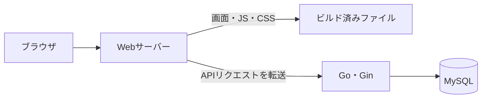

# 構成と技術選定

## 前提

Raspberry Pi 5で、自分の関心がある情報を集めて表示する。最初は株価の騰落率と出来高倍率を確認する画面を作る。

個人で管理できる構成と、技術を学ぶ機会を重視する。技術選定は性能だけで決めず、使い慣れていることや触ってみたいことも理由とする。

## 採用済みの技術

| 技術 | 役割 | 選定理由 |
| --- | --- | --- |
| Go | APIと取得・保存・分析処理 | Goを勉強したいため |
| Gin | HTTPのルーティングとHandlerの実行 | Ginを勉強したいため |
| MySQL | 銘柄と株価日足の保存 | 使い慣れているため |
| Docker Compose | API・DBなどの起動と接続の管理 | 自宅サーバーで複数のサービスをまとめて管理するため |

APIはJSONを返し、株価の分析はGo側で行う。フロントエンドは表示と操作を担当する。

## 構成要素と用途の一覧

| 構成要素 | 主な用途 | このプロジェクトでの役割 |
| --- | --- | --- |
| Svelte | UIの構築 | ブラウザ上で画面を表示し、入力と表示状態を扱う |
| TypeScript | 型による開発時の確認 | フロントのデータや関数の型を定義する。実行時にはJavaScriptになる |
| Vite | フロント開発・ビルド | 開発サーバーと変更の即時反映、本番用ファイルの生成を担当する |
| Node.js・npm | 開発・ビルドの実行環境と依存管理 | Viteなどを実行する。本番の配信用コンテナでは使用しない |
| Caddy | Web配信・リバースプロキシ | ビルド済みファイルを配信し、`/api/*`をGo APIへ転送する |
| Go・Gin | APIの実行 | HTTPリクエストを受け、データ取得や計算を行いJSONを返す |
| MySQL | データの永続化 | 銘柄と株価日足を保存する |
| Docker | 実行環境のイメージ化 | ビルド・配信・API・DBの環境を用意する |
| Docker Compose | 複数コンテナの構成管理 | `web`・`api`・`db`の起動、接続、ポート公開を定義する |

### ViteとCaddyの比較

以下はツールの機能比較。対応している機能が、すべて現在の設定で有効になっているわけではない。

| 比較 | Vite | Caddy |
| --- | --- | --- |
| 主な用途 | フロントエンド開発・ビルド | Web配信・リバースプロキシ |
| 開発中のAPI転送 | `server.proxy`で対応 | `reverse_proxy`で対応 |
| 本番のリバースプロキシ | 本構成では使用しない | Go APIへの転送を担当 |
| 静的ファイル配信 | 開発サーバーとビルド結果のローカルプレビューで対応 | 本番用のビルド済みファイルを配信 |
| フロントのビルド | ソースから`dist/`を生成 | 行わない |
| ソース変更の即時反映 | 開発サーバーで対応 | 本構成では再ビルドして反映 |
| HTTPS | 証明書などを設定して対応可能 | 条件に応じて証明書の取得・更新を自動化可能 |

Viteは開発・ビルド、Caddyは本番の配信という分担にする。`vite preview`はビルド結果のローカル確認用であり、本番サーバーには使用しない。

### 現在の使い分けと設定状況

| 場面 | 入口・コマンド | 現在の動作 |
| --- | --- | --- |
| ローカル開発 | `npm run dev`、通常`http://localhost:5173` | Viteが画面を提供し、`/api/*`を`localhost:8080`へ転送する。HTTPSは未設定 |
| 本番用ビルド | `npm run build` | Viteが`dist/`を生成する。DockerではNode.jsのビルド段階で実行する |
| Composeでの画面配信 | `http://localhost:3000` | Caddyがビルド済みファイルをHTTPで配信する |
| ComposeでのAPI呼び出し | `http://localhost:3000/api/ping`など | Caddyが`/api`を除いて`api:8080`へ転送する |
| APIへの直接アクセス | `http://localhost:8080/ping`など | 公開済みのAPIポートへ直接接続する。Caddyは経由しない |

Caddyも現在はHTTPのみで、HTTPSの自動化は有効にしていない。画面は開発時・Compose起動時ともに`/api/*`の相対URLでAPIを呼び出す。

## フロントエンドの構成

`apps/web`にSvelte・TypeScript・Viteを導入済み。ローカルの開発サーバーまたはComposeの`web`サービスで起動し、今日（日本時間）の騰落率を自動取得して表示する。

現在のパッケージ管理はnpmを使用し、`package-lock.json`を管理する。pnpmも候補として検討したが、移行は実施していない。

| 技術 | 役割 | 選定理由 |
| --- | --- | --- |
| Svelte | 画面と状態の管理 | 触ってみたい技術であり、最初の小さな画面を作りながら学ぶため |
| TypeScript | データや関数の型定義 | APIレスポンスなどの扱いをコード上で明確にするため。受信JSONの実行時検証は別途必要に応じて扱う |
| Vite | 開発サーバーと本番用ビルド | Svelte＋TypeScriptのテンプレートから小さく始められるため |

### 比較した選択肢

| 選択肢 | 今回の判断 |
| --- | --- |
| React＋TypeScript＋Vite | 当初の候補。今回はSvelteを学ぶ関心を優先した |
| Angular | 使用経験はあるが、今回は別の技術を試す |
| Vue | 本人の希望により今回は候補から外した |
| SvelteKit | ルーティングなどを含む選択肢。最初は1画面と既存Go APIで始めるため、現時点では導入しない |

現在の画面は、騰落率の表、読み込み中・データなし・エラーの表示を実装している。日付フォームは設けず、ページを開いた時点の今日を日本時間で求めて取得する。今日のデータがなければ過去日へ切り替えず空結果を表示する。APIが返す全件を表示し、件数を併記する。並べ替え・ページ分割・上位銘柄の抽出は行わない。出来高倍率の画面は今後追加する。

`src/models`にレスポンスの型、`src/api`に通信処理、`src/components`に表示専用コンポーネントを置く。`App.svelte`が初回表示時にAPIを呼び、取得結果・読み込み状態・エラーを画面内で保持する。対象日を明示し、共有ストアやキャッシュは導入しない。日付が変わった場合や再取得したい場合はページを再読み込みする。

## 本番の配信構成

配信サーバーにはCaddyを採用した。`apps/web/Dockerfile`でNode.jsによるビルドとCaddyによる配信を分け、生成されたHTML・CSS・JavaScriptだけを配信用イメージへコピーする。Node.jsは本番の配信用コンテナでは常駐させない。

`apps/web/Caddyfile`で静的ファイル配信とAPI転送を設定する。Composeの`web`サービスはホストの3000番ポートをコンテナの80番ポートへ割り当て、`api`に依存する。

Webサーバーを画面とAPIの共通の入口にする。`handle_path /api/*`で`/api`を除いて`api:8080`へ転送する。画面からは`/api/daily-volume-ratios`などの相対URLで呼び出せる。Go API側の`/daily-volume-ratios`などのパスは変更しない。

### 配信サーバーの比較と選定

| 選択肢 | 利点・考慮点 | 現時点の判断 |
| --- | --- | --- |
| Nginx | 静的ファイル配信とAPIへの転送を担当できる | 当初の候補。今回はCaddyの設定の簡潔さを優先した |
| Caddy | 同じ役割を短い設定で記述でき、HTTPS証明書の取得・更新も条件に応じて自動化できる | 個人で設定を管理しやすいことを重視して採用 |
| Goで直接配信 | Webサーバー用コンテナを減らせる。一方、画面とAPIのビルド・デプロイが結び付く | フロントを別コンテナで管理する方針のため、現時点では採用しない |
| Apache HTTP Server | 静的ファイル配信とAPIへの転送に対応する | 候補として比較。今回優先する理由は挙がっていない |

CloudFrontは配信元の手前でキャッシュ・配信するCDN。今回は自宅サーバーから直接配信する案とし、CDNは導入しない。これはCloudFrontとWebサーバーが同じ役割であることを意味しない。

家庭内での利用か外部公開か、ドメインやHTTPSの扱いは未決定。Caddyを採用しても、家庭内IPでのアクセスと公開ドメインでのアクセスでは証明書の扱いが異なる。

## 開発時の方針

ローカルで`npm run dev`によりViteの開発サーバーを使い、コード変更を画面に反映する。`npm run check`で型チェック、`npm run build`で本番用ファイルを生成する。本番はビルド済みファイルを配信する。Viteの`server.proxy`は`/api`を除いてホストのGo APIへ転送する。開発サーバーのコンテナ化は未対応。

## 参考資料

- [Svelteの概要](https://svelte.dev/docs/svelte/overview)
- [Viteの導入ガイド](https://vite.dev/guide/)
- [Viteの開発サーバー設定（API転送・HTTPS）](https://vite.dev/config/server-options.html)
- [Viteのビルドとローカルプレビュー](https://vite.dev/guide/static-deploy.html)
- [SvelteKitの概要](https://svelte.dev/docs/kit/introduction)
- [Nginxの静的配信・プロキシ設定](https://nginx.org/en/docs/beginners_guide.html)
- [Caddyの構成例](https://caddyserver.com/docs/caddyfile/patterns)
- [CaddyのHTTPS自動化](https://caddyserver.com/docs/automatic-https)
- [Goの静的ファイル配信](https://pkg.go.dev/net/http#FileServer)
- [Apacheのリバースプロキシ](https://httpd.apache.org/docs/2.4/howto/reverse_proxy.html)
- [CloudFrontの概要](https://docs.aws.amazon.com/AmazonCloudFront/latest/DeveloperGuide/Introduction.html)
